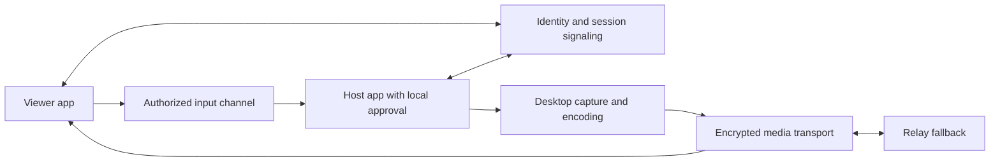

# AnyDesk investigation and independent implementation proposal

Date: 2026-10-18. Scope: local installed Windows AnyDesk 6.0.5.0.

An independent attended Windows app has since been implemented in `OpenDesk/`.
See `OpenDesk/README.md`, `OpenDesk/VERIFICATION.md`, and the portable app at
`OpenDesk/artifacts/app/OpenDesk.exe`. It supports multiple viewers, a single
remote controller, host approval and direct/relay TLS sessions. Version 0.2 adds
persistent numeric addresses, a self-hosted HTTPS directory, a familiar address-first
UI, chat, explicit clipboard/file sharing, screenshots and AVI recording. This is new
application code; it does not change the limits of the AnyDesk investigation.

This is a bounded static investigation, not a complete reconstruction. No AnyDesk
process was launched, no remote session was established, and no traffic was
captured. Original executable bytes were left unchanged.

## Artifact identity and reproducibility

| Artifact | Identity |
| --- | --- |
| Installed target | `C:\Program Files (x86)\AnyDesk\AnyDesk.exe` |
| Original bytes | 3,667,408 |
| Original SHA-256 | `dd7aa730255da936af74821fe2e90cbeec20a06f543f1fabf924d129f526c014` |
| File metadata | AnyDesk 6.0.5.0; philandro Software GmbH |
| Signature check | PowerShell Authenticode status Valid; signer philandro Software GmbH |
| Derived payload | `anydesk-payload.bin`, 10,366,464 bytes |
| Payload SHA-256 | `b779bd2bea7f17a99e7b85c27733f12d83806aa3e94e46e0de1010cb0c4e0bd1` |
| Analysis engine | REA 6.5.0 / Ghidra 12.1.4 |

`extract_payload.py` reconstructs the payload without running application code.
It checks the exact source digest, resolves the source PE section, reproduces the
observed byte transform, and decompresses the resulting LZMA1 stream. It refuses
to replace an existing payload. `payload-provenance.json` records the transformation.

The raw LZMA decoder consumed its input without reporting an end-of-stream marker.
The output length matches the loader's 0x9e2e00-byte argument, has MZ/PE headers,
and was independently admitted by REA as x86 PE.
This establishes a useful derived artifact, not byte-for-byte equivalence to a
live process image after relocations, import resolution, or later modifications.

`inspect_payload.py` reads the derived PE import table and scans bounded ASCII
strings. Its results are in `payload-inventory.json`. String matches include
translations and embedded library banners; neither strings nor imports prove
runtime use. This parser is specific to this PE32 investigation.

## Findings and evidence ledger

1. **Observed: native x86 PE wrapper.** Initial Ghidra analysis identified 52
   procedures and 25 defined strings. These are wrapper-analysis counts, not
   counts of all application functionality. The image has `.text`, `.itext`,
   `.data`, resource and relocation sections.
   Evidence: `ev_62a6f233e49fba1d3ac9eafa5c967ff9b7925186f77d306c98399c0907f5168d`.

2. **Observed: startup path into payload preparation.** Entry `0x401ce9` calls
   `0x401cc3`, which reaches `0x401976` and `0x401b5b`. `0x401937`
   transforms 0x37528a bytes beginning at analysis address `0xdf8000` using an
   LCG-derived XOR byte. `0x401976` passes five bytes of properties and the
   remaining bytes to a decoder. Reproducing that transform and LZMA1 decoding
   yields the derived PE described above.
   Evidence: `ev_1b466be0df1fc0dc747c4aa9426fe11340957bd96f6092e7e15971ec1085cb3c`,
   `ev_25a58eb233531d2f4ba5e991a745d78bab137cbd0f2ebdd47736549e2dec8da2`,
   `ev_1bbfeb29a7d51bc9fe089f065bad4ab2f8f3e101c6c3fae6beb249de0ff6e1b5`,
   `ev_6c887413f0307ff6ff91875b540c27dddf3b04d782120e2dee83e969e9e05cd1`.

3. **Observed: embedded PE loader structure.** Function `0x401000` checks MZ
   and PE signatures and copies headers and section content to destination
   addresses. This supports the inference that the outer executable wraps a
   separately prepared native image. It does not establish every loader step.
   Evidence: `ev_b3d1e6c2a896544351e4937f845f7cfe22b4b105d1d8701a075da52d13bac4cc`.

4. **Observed: Windows application resources.** The original resource tree has
   eight leaves: five icons, an icon group, version information, and a manifest.
   The manifest declares `asInvoker`, Windows compatibility identifiers, and
   per-monitor DPI awareness. `asInvoker` alone does not establish service or
   elevated-session behavior.
   Evidence: `ev_eb64eb6db01c217a17435be479686b0ae66c388264714fb423ef116ea534cfc1`,
   `ev_a7ac5560f75a9ce188caffeca7fdd3fc0523cb970367728bf542404cd77154dd`.

5. **Observed static candidates in the derived payload.** The local PE parser
   found 632 imports from 19 DLLs. Relevant examples include `SendInput`,
   `BitBlt`, OLE clipboard functions, `CreateServiceW`, Winsock functions,
   WinHTTP, and printing APIs. Strings mention `D3D11CreateDevice`, relay state,
   clipboard/file-transfer permissions, unattended access, DeskRT, and OpenSSL
   1.0.2p. These support subsystem hypotheses; they do not prove the negotiated
   encryption, active capture path, codec implementation, or protocol layout.
   Evidence: `payload-inventory.json`, bound to the derived SHA-256 above.

## What this means for building a similar app

The following is an independent architecture proposal. It is not a claim that
AnyDesk uses these components internally.

Build a Windows-first, attended-access MVP in these slices:

1. Host opens an explicit sharing window and shows a short-lived session code.
   Viewer requests access; host accepts. Show an active-session indicator and
   a local stop control throughout the connection.
2. Capture one selected monitor, encode frames, and render them on the viewer.
   Measure capture-to-display latency, frame drops, CPU and bandwidth.
3. Add mouse and keyboard input behind a separate host permission. Map viewer
   coordinates to the selected monitor and handle DPI and key-release cleanup.
4. Add authenticated signaling and direct connectivity with relay fallback.
   A session code locates a request; it must not independently authorize control.
5. Add clipboard, files, audio and multiple monitors as separately authorized
   capabilities after the basic session survives disconnects and reconnects.

For capture, Windows Desktop Duplication provides desktop frames, dirty/move
regions and pointer information. It is a reasonable candidate to evaluate for
the Windows host. See Microsoft's
[Desktop Duplication API](https://learn.microsoft.com/en-us/windows/win32/direct3ddxgi/desktop-dup-api).

For an initial transport, evaluate native WebRTC rather than designing a new
wire protocol. It supplies peer connectivity primitives; the application still
needs signaling, identity, consent and authorization. TURN provides a relay
when direct connectivity fails. See
[WebRTC peer connections](https://webrtc.org/getting-started/peer-connections) and
[TURN servers](https://webrtc.org/getting-started/turn-server).

The user confirmed **Windows first**. Plan the first host and viewer for Windows
x64, keeping capture, input and transport behind separate interfaces so later
platform support can reuse the session layer. Windows x64 is a proposed build
target; minimum supported Windows release, language and UI toolkit remain to be
selected. Do not copy this build's embedded library versions into a new
implementation. DeskRT text in a resource does not supply its encoder source.

### Windows-first implementation milestones

These are proposed acceptance criteria, not claims of completed implementation.
The platform answer confirms Windows first; it does not settle attended versus
unattended access or approve a particular technology stack.

| Milestone | Deliverable | Verification |
| --- | --- | --- |
| 1. Local capture | Select one monitor and preview captured frames in the host | Check monitor switching, cursor rendering, scaling and capture recovery after display changes |
| 2. Two-PC viewing | Viewer receives the selected desktop through an encrypted session | Test on two Windows PCs; measure latency, CPU, frame drops and bandwidth under idle, scrolling and video workloads |
| 3. Approved control | Host separately grants mouse and keyboard access; visible local stop control | Reject input before approval and after revocation; test DPI scaling, keyboard layouts and release of held keys on disconnect |
| 4. Internet connectivity | Session signaling, authenticated session binding, direct connection and relay fallback | Test direct connectivity and forced relay across separate networks; verify expired/replayed join requests fail |
| 5. Session resilience | Clean reconnect and explicit capability negotiation | Verify stale sessions cannot inject input and reconnect requires the intended authorization policy |

For the proposed attended-access MVP, run the host in the signed-in user's
desktop session. Service installation, unattended access, controlling elevated
applications and interaction with the Windows secure desktop need separate
product decisions and dedicated validation. They are not implied by ordinary
desktop sharing or by the `CreateServiceW` import found in AnyDesk.

## Investigation checklist and remaining work

The derived payload was admitted by REA, but Ghidra default auto-analysis did
not complete within its 330-second startup deadline (`provider_timeout`,
operation `list_documents`, run `b10725d8-f912-4019-8702-87ac1c0e9ae9`).
No completed payload procedure inventory or decompilation was returned.
`payload-analysis-status.json` preserves the concise failure details. Both native
sessions were closed. No repeated full analysis or tool configuration changes
were attempted. The remaining payload findings come from the separately labeled
offline parser, not from completed Ghidra payload analysis.

| Question | Status | Boundary / next evidence |
| --- | --- | --- |
| Which installed app and version? | Answered | Exact path, digest, metadata and signature |
| Native or managed/web package? | Answered | Native x86 PE wrapper and native x86 derived PE |
| Why does the first analysis show so little code? | Answered | Payload preparation and PE loading; reproducible offline extraction |
| Which subsystems should a similar app need? | Partially answered | Imports and string candidates; independent design proposal |
| Actual capture and input call paths? | Unresolved | Trace payload API callers and platform-selection logic |
| Codec and latency strategy? | Unresolved | Trace frame encode/decode and transport scheduling |
| Exact handshake, wire format and crypto parameters? | Unresolved | Focused code tracing plus a controlled two-device runtime session |
| Backend behavior and identity semantics? | Unresolved | Cannot reconstruct server implementation from client strings |
| Platform for replacement? | Answered | User confirmed Windows first |
| Independent Windows implementation? | Development MVP built | See OpenDesk/README.md and VERIFICATION.md; two-device/manual checks remain |

No actual remote-desktop behavior, encryption handshake, relay fallback, elevated
desktop handling or performance was tested in this pass. Decompiled pseudocode
is an analysis representation, not recovered original source. The evidence
bundle's unknown-record count is bookkeeping and does not mean these questions
are answered.
